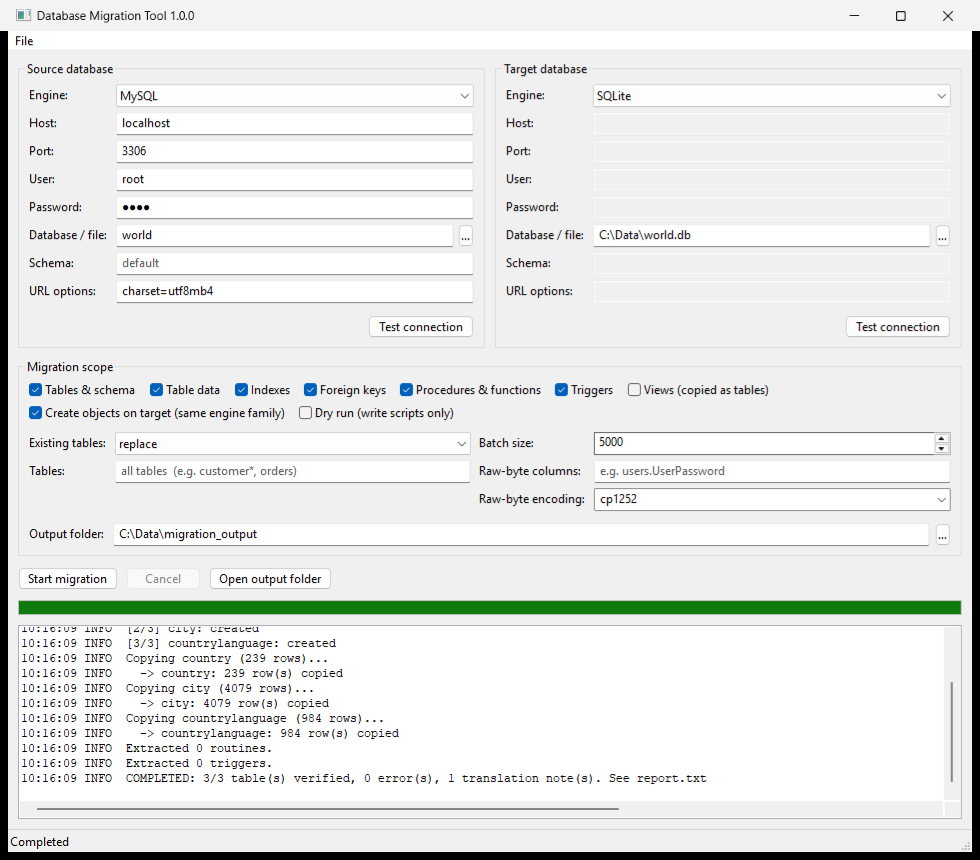

# Database Migration Tool

A wxPython desktop tool (and headless CLI) that migrates tables, indexes, foreign keys, data,
procedures/functions, and triggers between MySQL, MariaDB, SQLite, PostgreSQL, Oracle, SQL Server,
IBM DB2, Snowflake, and Amazon Redshift. It is built on SQLAlchemy 2.



It implements `data_migration_tool_runbook.md`, with the defects listed below fixed. It also carries
over the MySQL→SQLite lessons from `MfcSqLite/migrate_mysql_to_sqlite.py`.

## Quick start

```bash
python -m venv .venv
.venv\Scripts\pip install -r requirements.txt
.venv\Scripts\python migration_tool.py
```

Headless (for scheduled jobs or CI), using a job saved from the GUI with **File → Save job**:

```bash
set DBMIG_SOURCE_PASSWORD=...
python migration_tool.py --job job.json
```

Job files never store passwords. The process exits with 0 on success and 1 on any error.

Build the Windows binary. Use a clean venv: PyInstaller refuses to build if an obsolete `enum34`
package is visible to the interpreter.

```bash
pyinstaller DBMigrationTool.spec
```

The spec bundles only the drivers installed in the build environment.

## Replacing `migrate_mysql_to_sqlite.py`

Source **MySQL** (the database `...` button lists the server's schemas). Target **SQLite** with the
file path. Leave *Existing tables* on `replace`.

For the MFC app's `UserPassword` column, set **Raw-byte columns** to `vdl_users.UserPassword` and
keep **Raw-byte encoding** at `cp1252`. The XOR bytes were written through a latin1 connection into a
`utf8mb3` column, so they are stored as UTF-8 text. Encoding that text as cp1252 recovers the
original bytes, which land in SQLite as a BLOB, exactly as the old script did. A blank encoding
copies the server's stored bytes instead (`CAST AS BINARY`).

Tick **Views (copied as tables)** to also copy the old script's 4 `*_vw` views as data snapshots.

Other behaviour carried over from that script:

* Dates and times are written as plain `YYYY-MM-DD HH:MM:SS` text. SQLAlchemy would otherwise
  append `.000000`.
* MySQL `TIME` values (including values over 24h) become text.
* `''` in numeric columns becomes NULL.
* A single-column auto-increment integer PK becomes `INTEGER PRIMARY KEY AUTOINCREMENT`.
* The target uses `journal_mode=WAL` and `synchronous=NORMAL`.

Improvements over the old script:

* Data is streamed in batches instead of read with `fetchall()`.
* Indexes and foreign keys are migrated.
* Row counts are verified after the copy.
* There is a log and a report file, and a run can be cancelled.
* `DECIMAL` keeps its `NUMERIC(p,s)` declaration instead of `REAL`.

## Output

Each run writes `migration_output/<timestamp>_<src>_to_<tgt>/` containing:

| File | Content |
| --- | --- |
| `migration.log` | Full log, including tracebacks |
| `report.txt` | Per-table status, source and target row counts, and type and default translation notes |
| `schema.sql` | The exact target-dialect DDL that was run (or would run, in a dry run) |
| `routines.sql`, `triggers.sql` | Extracted object DDL in source syntax, ready for the source family's client (`DELIMITER`, `GO`, `/`) |

## Runbook evaluation

The runbook's architecture is sound: SQLAlchemy dialects with a threaded wx GUI. Its code, however,
would fail or silently produce wrong results in most real migrations.

| # | Runbook issue | Impact | Fix here |
| --- | --- | --- | --- |
| 1 | `row['Name']` / `row['Trigger']` on SQLAlchemy 2 rows | Routine and trigger extraction crashes on MySQL | Catalog queries with positional access |
| 2 | Reflected types are reused verbatim on another engine | `CREATE TABLE` fails for MySQL `TINYINT(1)`, collations, PG `VARCHAR` without length, `JSONB`, `ARRAY`, `ENUM`, ... | `translate_type()` converts to generic types, verifies they compile for the target, and falls back safely |
| 3 | Server defaults are copied verbatim | `nextval(...)`, `getdate()`, `'x'::varchar` break on other engines (and `nextval` breaks even PG→PG) | `translate_default()` keeps portable literals and `CURRENT_TIMESTAMP` and drops the rest (listed in the report) |
| 4 | Tables are created in alphabetical order with inline FKs | FK creation fails whenever a child sorts before its parent; FK cycles are impossible | Dependency order; FKs are added after the data load (inline for SQLite) |
| 5 | `fetchall()` of a whole table, inserted in one transaction | Runs out of memory on large tables | Server-side streaming in configurable batches |
| 6 | Password and parameters formatted into the URL string | Passwords containing `@ / : #` break the connection | `URL.create()` |
| 7 | Routines and triggers are only logged (60 chars); section 5's promised `.sql` output does not exist | Objects are never migrated | Full DDL extracted for 8 families, written to scripts, and executed on the target when the engine family matches |
| 8 | PG uses `information_schema.routines.routine_definition` and `information_schema.triggers` | Body only (not runnable); triggers duplicated per event | `pg_get_functiondef` / `pg_get_triggerdef` |
| 9 | MySQL: `SHOW PROCEDURE STATUS` only; `SHOW TRIGGERS` unfiltered | Functions missed; `DEFINER` clauses break on the target | `information_schema` for both, filtered by schema, `DEFINER` stripped |
| 10 | Re-running inserts duplicates; no handling of existing tables | Duplicate data | `skip` / `append` / `truncate` / `replace`; `replace` asks for confirmation |
| 11 | One exception aborts everything; no verification | Partial migrations go unnoticed | Per-table and per-object error isolation, row-count verification, `report.txt` |
| 12 | PG sequences are not reset after copying ids | First application insert fails with a duplicate key | `setval()` after the load |
| 13 | `cx_Oracle` (deprecated, needs Instant Client) | Extra install burden | `oracledb` thin mode |
| 14 | Snowflake warehouse is passed through the *port* field | Confusing, and the schema can't be set | Generic *URL options* field (`warehouse=...&role=...`) plus a *Schema* field |
| 15 | Spec file: `block_cipher` / `win_private_assemblies` were removed in PyInstaller 6; entry-point dialects aren't bundled | Build fails; Snowflake, Redshift and DB2 fail in the `.exe` | PyInstaller 6 spec; dialects registered explicitly in code |
| 16 | No cancel, no connection test, no dry run, no saved settings | Hard to operate | Cancel button, **Test connection**, schema browser, dry run, job files and CLI |
| 17 | Section 5 calls MySQL's procedural language "PL/SQL" | Doc error | PL/SQL is Oracle's; MySQL uses SQL/PSM-style syntax |

## Known limits

* Cross-engine procedural code is **not translated** (MySQL→PG, T-SQL→PL/SQL, and so on). It is
  exported for manual conversion, as the runbook's compatibility matrix intends.
* Views, sequences, user-defined types, grants, and partitioning are not migrated.
* `CHECK` constraints and computed-column expressions are dropped across engines. They are copied
  within the same engine family.
* Data is committed per batch. If a table fails mid-way, the rows already copied stay, and the
  report shows a mismatch.
* Verified:
  * SQLite→SQLite end to end (tests and the built `.exe`).
  * DDL generation for MySQL, PostgreSQL, Oracle and SQL Server targets.
  * A live MySQL 8 (`vdldb`, 68 tables + 4 views, 44k rows)→SQLite run compared cell by cell with
    `migrate_mysql_to_sqlite.py`. All values match except two deliberate differences:
    * `TIME` values are written as `00:00:00` (MySQL's format) instead of Python's `0:00:00`.
    * `DECIMAL(65,0)` values are stored as integers instead of reals.

  PostgreSQL, Oracle, MSSQL, DB2, Snowflake and Redshift have **not** been run against live servers.

## Tests

```bash
.venv\Scripts\python -m unittest discover -s tests -v
```

Smoke-test a built executable (headless SQLite→SQLite job):

```bash
python scripts/smoke_test_exe.py dist/DBMigrationTool.exe
```

## CI and releases

[`.github/workflows/build.yml`](.github/workflows/build.yml) runs on GitHub Actions (Windows runners).

Each run does: version → unit tests → build the exe (`requirements-build.txt`) → smoke test → package.

| Trigger | Version | Release? | Where to download |
| --- | --- | --- | --- |
| Pull request, or push to another branch | `<next>.dev<run>+<sha>` | No | **Actions** → the run → **Artifacts** (14 days) |
| Push to `main`/`master` | Next version from commit messages (below) | **Yes**: the commit is tagged `vX.Y.Z` automatically | **Releases** page (artifact kept 90 days) |
| Push a `v*` tag yourself | Exactly the tag | Yes | **Releases** page |
| **Run workflow** button (Actions tab) | Choose `auto`, `patch`, `minor`, `major` or `none` | Unless `none` | **Releases** page |

How the next version is chosen from the commits since the last `vX.Y.Z` tag
([`scripts/next_version.sh`](scripts/next_version.sh)) follows [Conventional Commits](https://www.conventionalcommits.org/):

| Commits since the last release include | Bump | Example |
| --- | --- | --- |
| `type!:` subject, or `BREAKING CHANGE:` in the body | major | `refactor!: rename job options` → 1.4.2 → **2.0.0** |
| `feat:` | minor | `feat(gui): views option` → 1.4.2 → **1.5.0** |
| any other message (`fix:`, `perf:`, or no prefix) | patch | `fix: null dates` → 1.4.2 → **1.4.3** |
| only `docs:`, `ci:`, `chore:`, `test:`, `style:`, `build:` | no release | |

* Add `[skip release]` to the head commit message to push without releasing. Those commits still
  count towards the next release.
* With no release tag yet, the first release uses `__version__` from `dbmigrator/__init__.py`
  (currently **1.0.0**). After that, tags are the source of truth, and the build stamps the version
  into the exe.
* Versions containing `-` (e.g. a hand-pushed `v1.1.0-rc1`) are published as pre-releases and are
  ignored when calculating the next version.
* Release notes are generated from the merged pull requests and commits since the previous tag.

Each build produces `DBMigrationTool-<version>-win64.exe`, a `.zip` (exe + README) and `SHA256SUMS.txt`.

Preview what a push would release:

```bash
EVENT=push REF_NAME=master bash scripts/next_version.sh
```

Bundled drivers are pinned in `requirements-build.txt`: MySQL/MariaDB, PostgreSQL/Redshift (psycopg2),
Oracle and SQL Server. SQL Server still needs the Microsoft ODBC driver installed on the user's
machine. Add `snowflake-sqlalchemy`, `sqlalchemy-redshift` or `ibm_db_sa` there to bundle those engines.
